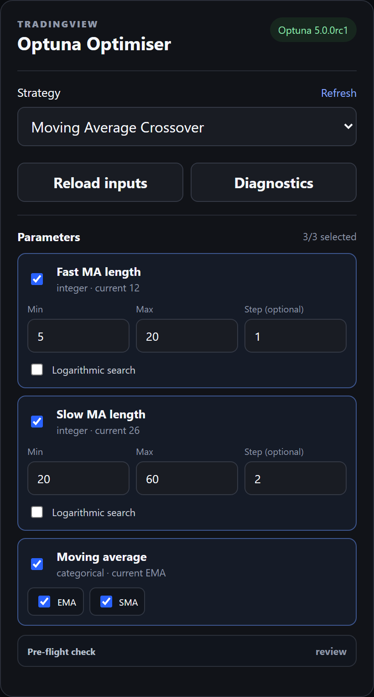
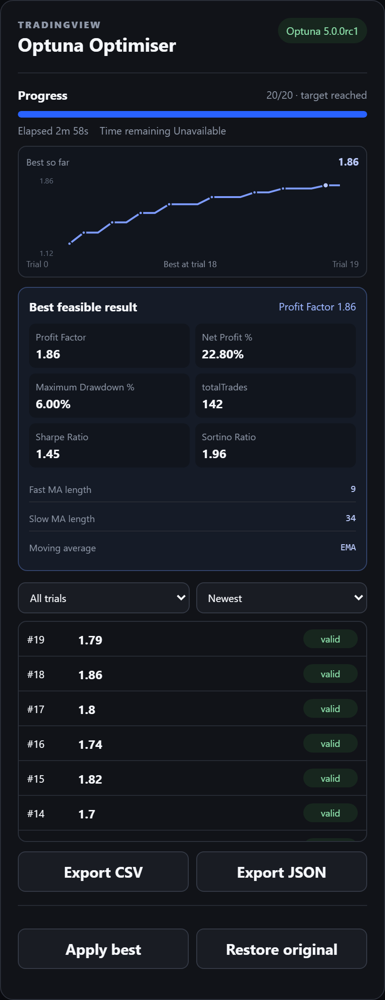

# TradingView Optuna Optimiser

Optimise a Pine strategy on your current TradingView chart with a Chrome or Firefox extension and a local Optuna service.

TradingView runs the backtests. The extension applies parameters and reads Strategy Tester results. The local backend chooses the next trial and saves the study.

[Get started](#get-started) · [Search settings](docs/optimisation.md) · [Research guide](docs/research.md) · [Development](docs/development.md)

## Screenshots

Extension panels rendered with illustrative sample data.

| Parameter setup                                                                                                                       | Study results                                                                                                                                   |
| ------------------------------------------------------------------------------------------------------------------------------------- | ----------------------------------------------------------------------------------------------------------------------------------------------- |
|  |  |

## What you can do

| Task            | Tools                                                                                         |
| --------------- | --------------------------------------------------------------------------------------------- |
| Define a search | Numeric ranges, steps, logarithmic sampling and conditional inputs                            |
| Choose a result | Profit factor, net profit, Sharpe, Sortino, drawdown or win rate, with result filters         |
| Track a study   | Live progress, time estimates, best-result chart and trial history                            |
| Check results   | Unseen-data validation, parameter stability, walk-forward studies and trade-level Monte Carlo |
| Save your work  | Named configurations, resumable runs, experiment comparison and CSV/JSON exports              |

The optimiser verifies parameter writes and checks the strategy, symbol and timeframe during a run. It reuses identical completed trials within the same study and stops when it has tested every reachable combination in a finite search space.

## Get started

You need Python 3.12 or later, `uv`, Bun 1.4.4 or later and Chrome or Firefox. The repository pins Bun in [package.json](package.json). Deep Backtesting options require access to that feature in your TradingView account.

### 1. Install dependencies

Run from the repository root:

```sh
bun install
cd backend
uv sync
```

### 2. Start the local backend

In the `backend` directory:

```sh
uv run uvicorn app.main:app --host 127.0.0.1 --port 8765
```

Keep this terminal open. The backend prints a pairing code for the extension.

### 3. Start the extension

In a second terminal at the repository root, choose your browser:

```sh
bun run extension:dev
```

For Firefox, use `bun run extension:dev:firefox`.

Open a TradingView chart with a Pine strategy, open the optimiser panel and enter the backend's pairing code.

Use the extension toolbar button to hide or show the panel. Hiding it keeps the current run, validation and form state active.

On Windows, you can also [build a companion executable](docs/development.md#windows-companion) to run the backend without a development terminal.

## Run your first study

1. Select the strategy and click **Read inputs**.
2. Enable the inputs you want to optimise and set their ranges or choices.
3. Choose a metric and a small trial budget, such as 5 to 20 trials, to check the setup.
4. Click **Start optimisation** and review the trial results.
5. Apply the best parameters, restore the original settings or export the results.

Research checks are optional. Enable them before starting a study, then click **Run validation** after optimisation finishes. The [research guide](docs/research.md) explains each check and its limits.

## Find the details

| Guide                                         | Contents                                                                                         |
| --------------------------------------------- | ------------------------------------------------------------------------------------------------ |
| [Optimisation settings](docs/optimisation.md) | Objectives, filters, steps, logarithmic search, conditions and trial reuse                       |
| [Research and results](docs/research.md)      | Convergence, unseen-data validation, stability, walk-forward, Monte Carlo and experiment history |
| [Development](docs/development.md)            | Builds, checks, Windows packaging and local storage                                              |
| [Code structure](docs/architecture.md)        | Extension modules, TradingView integration and backend responsibilities                          |

If TradingView controls or reports stop working, open **Diagnostics** in the panel. The compatibility checks report which integration capability failed.
